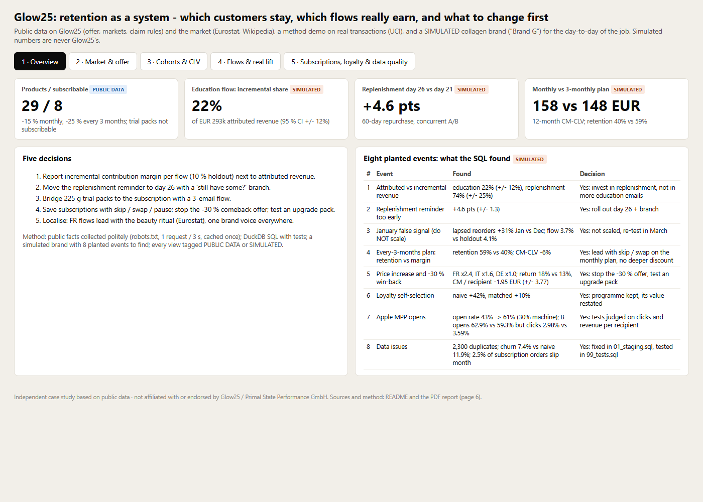

# Glow25: retention as a system - which customers stay, which flows really earn, and what to change first

**[Read the report (PDF)](https://albt-france.github.io/glow25-retention-clv-case-study/report/glow25_retention_case_study.pdf) · [Open the interactive dashboard](https://albt-france.github.io/glow25-retention-clv-case-study/dashboard/)**

<sub>Fallback links in this repository: [site/report/glow25_retention_case_study.pdf](site/report/glow25_retention_case_study.pdf) · [site/dashboard/index.html](site/dashboard/index.html) (download and open in a browser)</sub>

An independent case study for the **Retention & CLV Operator** role: for a collagen brand that sells on
subscription, which lifecycle moments create value **in contribution margin, not in attributed revenue**, and how
to build and test them across seven markets.

- **Real part (PUBLIC DATA):** Glow25's public offer (29 products, 8 subscribable at -15 % monthly or -25 % every
  3 months, 225 g trial packs that cannot be subscribed), its 7 declared markets, the EU rule on collagen claims
  (Regulation 432/2012: only through vitamin C), Eurostat online buying by country, Wikipedia seasonality, and a
  cohort / CLV method demo on real transactions (UCI Online Retail II).
- **Simulated part (SIMULATED):** the day-to-day of the job for a fictional collagen brand, **"Brand G"**:
  24 months, about 120,000 customers, 8 Klaviyo-style flows with 10 % holdouts, subscriptions, loyalty, and
  8 planted events to find. Simulated numbers are never presented as Glow25's.

## Four key results

| | Result | Data |
|---|---|---|
| 1 | The education flow claims the most revenue (about EUR 302k, last touch), but only **about 22 %** of it is incremental against its 10 % holdout; the replenishment flow is mostly incremental. **Invest in replenishment.** | SIMULATED |
| 2 | One-off buyers reorder around day 32-34; a reminder on **day 26 with a "still have some?" branch beats day 21 by +4.6 points** of 60-day repurchase (concurrent A/B). | SIMULATED, jar duration from the public catalogue |
| 3 | The every-3-months plan keeps more subscribers (59 % vs 40 % at 12 months) but **earns about 6 % less margin per subscriber**; a -30 % comeback offer brings people back at a **negative incremental margin**. Save with skip / swap / pause, not with discounts. | SIMULATED, plan discounts are Glow25's public ones |
| 4 | France buys beauty online far more than supplements (women 25-54: 29.1 % vs 11.8 %): FR flows should lead with the **beauty ritual**, adapted, not translated. | PUBLIC DATA (Eurostat 2024) |



## What is inside

| Deliverable | Where |
|---|---|
| 7-page report (PDF) | [site/report/glow25_retention_case_study.pdf](site/report/glow25_retention_case_study.pdf) |
| Interactive dashboard, 5 tabs (one HTML file, works offline) | [site/dashboard/index.html](site/dashboard/index.html) |
| Retention economics workbook (real formulas; blue = inputs): order margin, monthly vs 3-monthly, flow holdouts, sample size, checks | [excel/retention_economics.xlsx](excel/retention_economics.xlsx) |
| SQL (DuckDB): staging, KPIs, cohorts, contribution margin, holdout read-outs, timing, subscriptions, January trap, loyalty bias, MPP, UCI demo, tests | [sql/](sql/) |
| Notebook (executed): real -> simulation -> cohorts -> flows -> subscriptions -> traps -> decisions | [notebooks/glow25_retention.ipynb](notebooks/glow25_retention.ipynb) |
| Retention strategy, 8 Klaviyo flow specs, experiment playbook, KPI dictionary, localisation playbook, weekly update, claims guardrail, AI copy workflow, data issues log, assumptions | [docs/](docs/) |
| Email copy: 4 flows x 2 emails in English + French adaptations, all passed through the claims check | [copy/](copy/) |

## Methods

- **Collection** (`src/collect_public.py`): public pages only, `robots.txt` respected, at most 1 request every
  3 seconds to Glow25 domains, every response cached once; no account, cart, checkout, newsletter sign-up or
  form. `products.json` (rate-limited) and EUR-Lex (bot check) are not used: product data comes from
  `/products/<handle>.js`, the regulation from the Publications Office copy. User-Agent `retention-case-study/1.0`.
- **Simulation** (`src/simulate_retention.py`, seed 42): real prices, plan discounts and product types; market
  weights from Eurostat; January peak from Wikipedia; a 30-day jar (450 g, 15 g servings from the trial pack
  label); assumptions in [docs/assumptions.md](docs/assumptions.md). Eight events are planted, then found by SQL.
- **Analysis**: DuckDB SQL with CTEs and window functions; holdout read-outs with 95 % intervals; incremental
  contribution margin; cohort CM-CLV; matched comparison for loyalty; empirical CLV and a hand-written BG/NBD +
  Gamma-Gamma back-test on UCI (`src/clv.py`); assertions in `sql/99_tests.sql`; workbook checks recomputed.
- **Claims**: every email and doc passes `src/claims_check.py` (authorised vitamin C wordings only, banned
  words, unsourced evidence claims), then a person. Not legal advice.
- **Copy lab** (`src/copy_lab.py`): customer research on simulated cancel reasons, subject-line variants from
  templates, claims check; a language-model step (optional) can be switched on in `.env`; the repository uses
  the template fallback and runs without any key.
- AI-assisted workflow: I used Claude, mainly to write scripts faster. I drove the project: I defined the questions, chose and validated the data sources, made the analytical decisions and checked every result.

## How to re-run

Python 3.10+, then `pip install -r requirements.txt`. No key is needed. From the repository root, in this order:

```
python src/collect_public.py
python src/simulate_retention.py
python src/run_sql.py
python src/clv.py
python src/claims_check.py copy/
python src/build_excel.py
python src/build_dashboard.py
python src/build_pdf.py
```

`collect_public.py` keeps the files already in `data/public/` (use `--refresh` to collect again, politely).
Optional: `python src/copy_lab.py` (copy lab), and `jupyter nbconvert --to notebook --execute --inplace notebooks/glow25_retention.ipynb`.
The PDF is printed by Edge or Chrome in headless mode.

## Sources and licences (read 2026-11-24)

| Source | What | Licence / terms |
|---|---|---|
| glow25.de: `/de-de`, product sitemap, `/products/<handle>.js`, article sitemaps of the country domains | offer, prices, subscription plans, markets (`hreflang`), content library | public pages, used for facts only; no logo, no images |
| Ashby public job board API (`api.ashbyhq.com/posting-api/job-board/glow25`) | the job posting | public API |
| Regulation (EU) No 432/2012, Publications Office copy (`publications.europa.eu/resource/celex/32012R0432`), EN and FR | authorised health claims | EU legal text, reuse allowed |
| Eurostat `isoc_ec_ibgs` (data updated 2026-04-17) | online purchases of supplements / beauty, women 25-54, 2024 | Eurostat reuse policy (CC BY 4.0) |
| Wikimedia pageviews API | collagen article views, 5 languages, Nov 2023 - Oct 2026 | CC0 |
| UCI Online Retail II (UCI Machine Learning Repository, 2019), `archive.ics.uci.edu/dataset/502` | 1,067,371 rows of a UK online retailer, 2009-2011 | CC BY 4.0 |
| Nager.Date public holidays API; ECB EUR/GBP reference rate | local moments; GBP reporting | public APIs |

Company statements are quoted as stated by Glow25 and not verified: "Deutschlands Nr. 1" (product title),
"Vertraut von über 2,5 Million Frauen" (home page), "one of Europe's fastest-growing collagen brands" (job posting).

## Limits

- All internal data (customers, orders, subscriptions, email events) is **simulated**: it shows the method and the
  decisions, not Glow25's results. The planted effects come with intervals; some are noisy by design.
- UCI is a UK gifts and homewares retailer with many wholesale buyers: a method demo, not a benchmark for
  collagen buyers.
- No Klaviyo or Recharge account was used; flow specs use standard Klaviyo vocabulary without claiming interface
  details.
- The claims guardrail is a filter, not legal advice.

<sub>Independent case study based on public data · not affiliated with or endorsed by Glow25 / Primal State Performance GmbH</sub>
